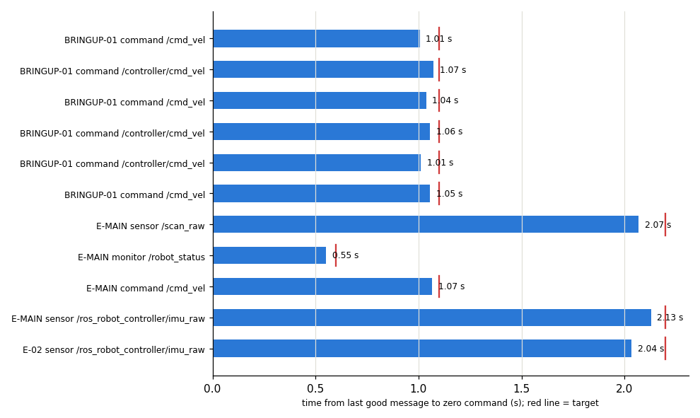
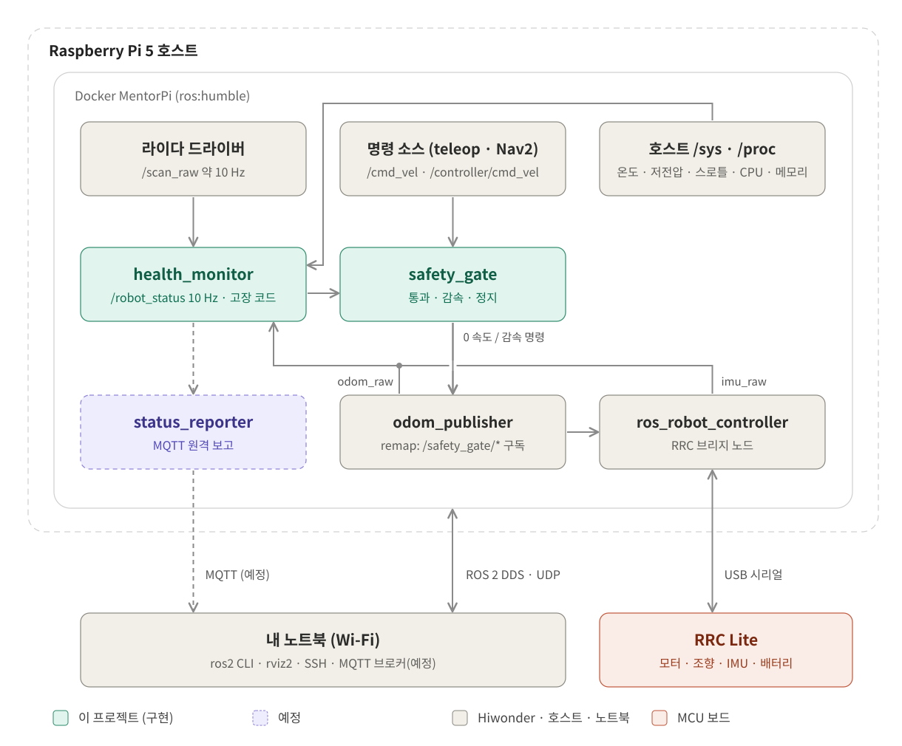
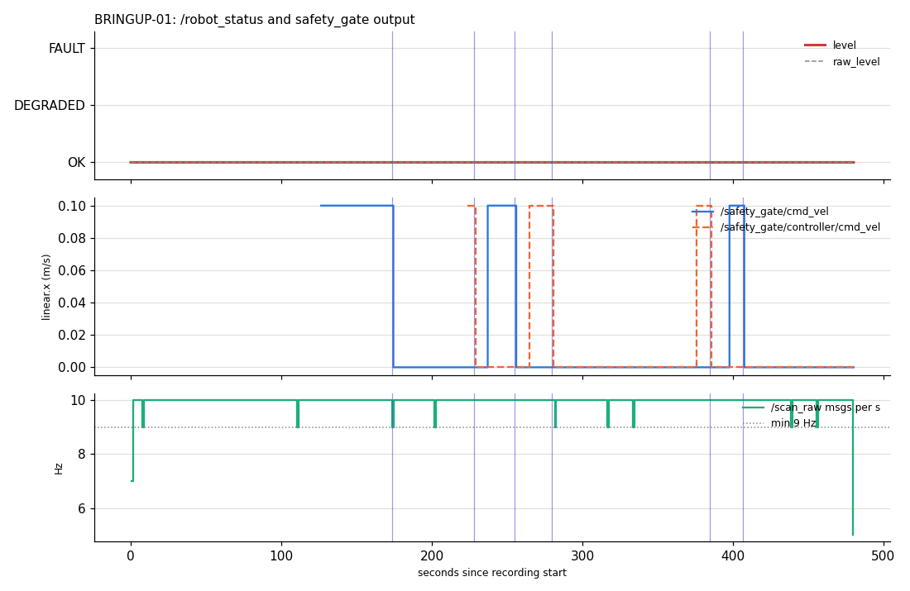
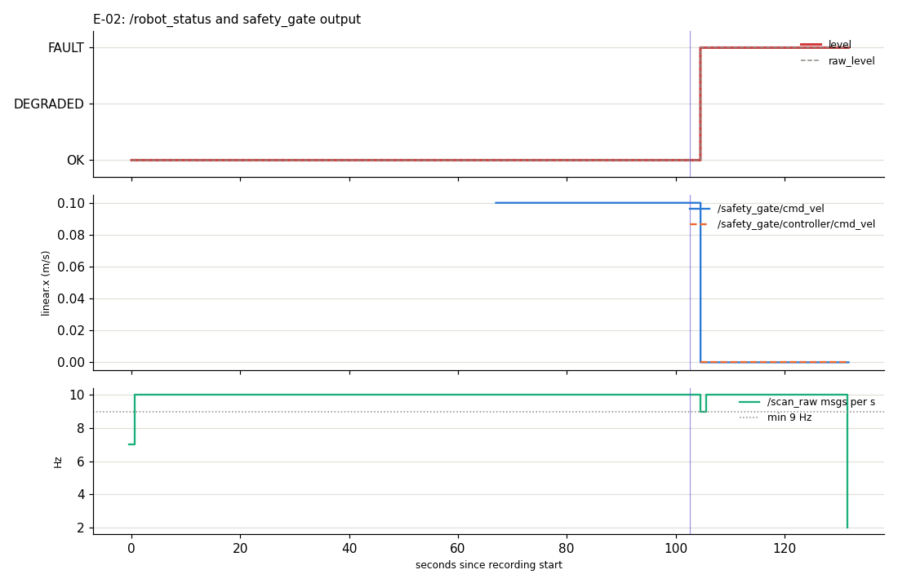
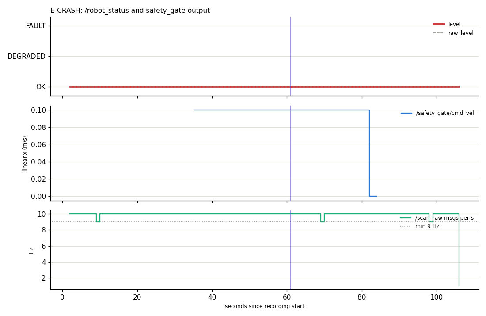

# ROS2 Auto Car

[](https://github.com/hyun-devlog/ros2-autocar/actions/workflows/ci.yml)

ROS 2 로봇을 위한 감시·안전 계층. Hiwonder MentorPi A1 실물 로봇에서 장애를 주입해 검증했습니다.

> 장애 감지·진단·복구를 소프트웨어가 스스로 감지하고, 안전하게 대응하고, 원인을 고장 코드로 보고합니다.

## 핵심 결과

바퀴를 띄운 실물 로봇에서 0.1 m/s로 주행하는 중에 장애를 주입하고, rosbag 녹화로 시간을 측정했습니다.

| 장애 | 감지 | 정지 명령 | 목표 | 결과 |
|---|---|---|---|---|
| 라이다 끊김 | 2.017 s | 2.068 s | ≤ 2.2 s | 정지 |
| 모터 보드(RRC) 통신 노드 종료 (2회) | 2.013 s, 2.058 s | 2.035 s, 2.129 s | ≤ 2.2 s | 정지 |
| 명령 입력 끊김 (7회) | — | 1.005~1.074 s | ≤ 1.1 s | 정지 |
| 감시자(health_monitor) 종료 | — | 0.552 s | ≤ 0.6 s | 정지 |
| **safety_gate 크래시** | 감지 안 됨 | 없음 | — | **정지 실패** (21.2 s 회전) |
| **모터 보드 통신 노드 크래시** | (기록 손실) | 전달 경로 없음 | — | **정지 실패** (전원 차단) |

"정지 명령"은 safety_gate가 0 속도를 낸 시각입니다. 0 속도가 실제 바퀴 정지로 이어지는 것은 BRINGUP-01(6회)에서 육안으로 확인했습니다. E-02에서는 모터 보드 통신 노드가 종료 처리를 하면서 바퀴가 바로 멈췄고, 약 2초 뒤 나온 safety_gate의 0 속도는 모터로 가는 유일한 경로인 그 노드가 이미 없어 전달되지 않았습니다.

**센서·감시자·명령 소스의 고장은 1~2초 안에 정지로 바꿉니다. 안전 계층 자체나 모터 보드 통신 노드가 크래시하면 소프트웨어로는 멈출 수 없고, 하드웨어 비상 정지나 펌웨어 명령 timeout이 필요합니다.** 무엇을 막고 무엇을 못 막는지를 실험으로 구분했습니다.



### 실험 영상

**BRINGUP-01 · 명령 입력 끊김 → 약 1초 뒤 바퀴 정지**

[BRINGUP-01 실험 영상](https://drive.google.com/file/d/1epcbWuGNcLr2VyaOawzaJHuR_dRXKn4F/view?usp=sharing)

**E-02 · 모터 보드 통신 노드 정상 종료 → 노드 종료 처리로 바퀴 정지, safety_gate는 약 2초 뒤 감지**

[E-02 실험 영상](https://drive.google.com/file/d/1hbS0iNB1aGlSq16TM5uspNZB2X0_rTsO/view?usp=sharing)

**E-06 · safety_gate 크래시 → 바퀴가 계속 돎 → 수동 정지 (의도한 실패 확인, RR-01)**

[E-06 실험 영상](https://drive.google.com/file/d/1m6fFbD4O7aCffrUYhZoL1rYdzmr6d-8-/view?usp=sharing)

<details>
<summary>나머지 실험 영상 (E-01, E-05, E-02b)</summary>

**E-01 → E-05 (한 번의 주행에서 연속 진행)**

라이다 끊김 → 약 2초 뒤 정지 → 복구 후 주행 재개 → 감시자(health_monitor) 종료 → 약 0.5초 뒤 정지

[E-01 & E-05 실험 영상](https://drive.google.com/file/d/1UCMoBKDGYdFJJWL_zyMkouGTziGRTCqv/view?usp=sharing) (E-01은 원본 E01_TIME부터, E-05는 E05_TIME부터)

**E-02b · 모터 보드 통신 노드 크래시 → 바퀴가 계속 돎 → 전원 차단 (의도한 실패 확인, RR-04)**

[E-02b 실험 영상](https://drive.google.com/file/d/1Pr5K5tJE98Ju-y5ypNUvO9QDckN_8PCJ/view?usp=sharing)

</details>

## 특징

- **벤더 코드 무수정**: Hiwonder 토픽을 구독만 하고, 모터 명령 경로는 노드 지정 remap으로 끼워 넣습니다.
- **판정 로직과 ROS 분리**: 판정 코드는 rclcpp에 의존하지 않아 로봇 없이 GoogleTest로 검증합니다 (테스트 33개, CI).
- **근거 있는 기준값**: 기준은 공식 문서나 실측에서 가져오고, 근거가 없는 값은 설계값으로 표시합니다.
- **안전 요구사항 추적**: 실험으로 찾은 위험 → 요구사항(SR) → 코드 → 단위 테스트 → 실험 결과로 이어집니다.
- **실패도 기록**: 막지 못한 경우를 잔여 위험으로 남깁니다.

## 구조

### 하드웨어


### 소프트웨어



- 초록색이 이 프로젝트가 추가한 노드입니다. Hiwonder 노드(회색)는 수정하지 않았습니다.
- `odom_publisher`의 명령 입력 두 개(`/cmd_vel`, `/controller/cmd_vel`)를 launch에서 `/safety_gate/*`로 remap해, 모든 모터 명령이 safety_gate를 지나가게 했습니다.
- health_monitor는 라이다(`/scan_raw`), IMU(`imu_raw`), 오도메트리(`odom_raw`) 토픽과 호스트 상태를 감시합니다.
- 모터로 가는 경로는 `ros_robot_controller` 하나뿐입니다. 이 노드나 safety_gate가 크래시하면 소프트웨어로는 멈출 수 없습니다 (RR-01, RR-04).
- 점선(status_reporter, MQTT)은 로드맵의 지표 v3입니다.


| 패키지 | 역할 |
|---|---|
| `robot_interfaces` | `RobotStatus`, `FaultItem` 메시지 |
| `health_monitor` | 토픽 도착 시각과 주기 감시, Pi 상태 수집, 등급 판정, `/robot_status` 발행 |
| `safety_gate` | 등급에 따라 명령 통과·감속·정지, 입력 끊김과 상태 끊김 시 0 속도 |
| `supervisor_bringup` | Hiwonder launch를 수정 없이 포함하고, 모터 입력 두 개를 gate 출력으로 remap |

### 등급과 대응

| 등급 | 의미 | safety_gate |
|---|---|---|
| OK (0) | 모든 감시 항목 정상 | 명령 그대로 통과 |
| DEGRADED (1) | 동작 가능, 성능 저하 | 속도 × 0.5 |
| FAULT (2) | 안전한 동작 불가 | 모든 입구에 0 속도를 10 Hz로 반복 |
| 상태 없음 / 0.5 s 끊김 | 감시자 고장 | FAULT와 같음 |

고장 원인은 SAE J2012 DTC 형식을 빌린 코드로 보고합니다 (예: `U1002` 토픽 수신 끊김, `B1002` SoC 85 °C 이상). 전체 표: [`docs/fault_codes.md`](docs/fault_codes.md)

## 환경 세팅

### 대상 환경

| 항목 | 내용 |
|---|---|
| 로봇 | Hiwonder MentorPi A1 (Ackermann 섀시), Hiwonder 기본 이미지 |
| 상위 제어기 | Raspberry Pi 5, Docker 컨테이너 `MentorPi` (`ros:humble`) |
| 하위 제어기 | RRC Lite (STM32F407), USB 시리얼 |
| 라이다 | LD19, `/scan_raw` 10 Hz |
| ROS | ROS 2 Humble, C++17 (rclcpp), Python 3.10 |

### 1. 컨테이너 접속

```bash
docker exec -it -u ubuntu -w /home/ubuntu MentorPi zsh
~/.stop_ros.sh          # 자동 시작된 Hiwonder 노드 정리
```

root가 아니라 `ubuntu` 사용자로 들어가야 Hiwonder 환경이 정상 동작합니다. 컨테이너의 `~/shared`는 호스트의 `/home/pi/docker/tmp`와 공유됩니다.

### 2. 받기와 빌드

```bash
cd ~/shared
git clone https://github.com/hyun-devlog/ros2-autocar.git
cd ros2-autocar
colcon build --symlink-install
source install/setup.zsh
echo 'source ~/shared/ros2-autocar/install/setup.zsh' >> ~/.zshrc
```

### 3. 단위 테스트

```bash
colcon test --packages-select health_monitor safety_gate
colcon test-result --verbose      # 33 tests, 0 failures
```

같은 테스트가 push마다 GitHub Actions(`ros:humble` 컨테이너)에서 실행됩니다.

## 실행

**바퀴를 바닥에서 띄운 상태에서** 시작하세요.

```bash
ulimit -c 0     # 벤더 라이다 드라이버가 종료 시 남기는 코어 덤프 방지
ros2 launch supervisor_bringup bringup.launch.py
```

시작하면 health_monitor와 safety_gate가 먼저 뜨고, gate는 상태를 받기 전까지 STOP입니다. 경로가 제대로 연결됐는지 바퀴를 움직이기 전에 확인합니다.

```bash
for t in /cmd_vel /controller/cmd_vel /safety_gate/cmd_vel /safety_gate/controller/cmd_vel; do
  echo "== $t"; ros2 topic info -v $t | grep -E "Node name|Endpoint type"
done
```

`/cmd_vel`과 `/controller/cmd_vel`은 **safety_gate만** 구독하고, `/safety_gate/*`는 `odom_publisher`가 구독해야 합니다.

## 실험 방법

### 도구

| 도구 | 용도 |
|---|---|
| `tools/record_experiment.sh <ID>` | 상태·명령·gate 출력·센서 토픽을 rosbag으로 녹화. 전원 차단에 대비해 캐시 없이 쓰고 1초마다 sync |
| `tools/run_logged.sh <log> <command>` | 노드 로그를 화면과 파일에 함께 저장 |
| `tools/bag_timeline.py <bag>` | 토픽 멈춤·재개·값 변화를 시간순으로 출력 |
| `tools/supervisor_metrics.py <bag...>` | 고장 구간을 자동으로 찾아 지표 계산, 표와 그래프 생성 (`python3-matplotlib` 필요). 지표 정의: [`docs/metrics.md`](docs/metrics.md) |

### 절차

1. bringup 실행, 경로 확인
2. `tools/record_experiment.sh E-xx`로 녹화 시작
3. `ros2 topic pub -r 10 /cmd_vel geometry_msgs/msg/Twist "{linear: {x: 0.1}}"`로 바퀴 회전
4. 아래 방법으로 장애 주입, 바퀴 관찰(영상 촬영)
5. 녹화 종료 후 `tools/supervisor_metrics.py`로 분석

| ID | 장애 | 주입 방법 | 관련 |
|---|---|---|---|
| E-01 | 라이다 끊김 | `pkill -INT -f ldlidar_stl_ros2_node` | SR-01, SR-09 |
| E-02 | 모터 보드 통신 노드 종료 | `kill -INT <ros_robot_controller PID>` | SR-02 |
| E-03 | 명령 입력 끊김 | 명령 발행을 Ctrl+C | SR-04 |
| E-04 | 우회 경로 | `ros2 topic info -v`로 구독자 확인 | SR-05 |
| E-05 | 감시자 종료 | `pkill -INT -f health_monitor_node` | SR-13 |
| E-06 | safety_gate 크래시 | `kill -KILL <safety_gate PID>` | 잔여 위험 RR-01 |
| E-02b | 모터 보드 통신 노드 크래시 | `kill -KILL <ros_robot_controller PID>` | 잔여 위험 RR-04 |

`pkill -f`는 이름이 같은 다른 프로세스(예: 녹화)까지 끌 수 있으므로, 모터 보드 노드처럼 이름이 겹치는 경우에는 `pgrep -af`로 PID를 확인한 뒤 하나만 종료합니다.

## 결과

전체 표: [`docs/metrics/summary.md`](docs/metrics/summary.md) · 실험 기록: [`docs/experiments/`](docs/experiments/)

### 라이다 끊김과 감시자 종료 (E-01, E-05)

라이다가 끊기자 2.0 s에 FAULT, gate가 0을 내고, 라이다가 돌아오자 2.0 s 회복 대기 후 주행을 재개합니다. 감시자가 사라지면 gate가 0.55 s 만에 스스로 정지합니다.


### 명령 입력 끊김 (E-03)

두 입구(`/cmd_vel`, `/controller/cmd_vel`)를 번갈아 6회 끊었고, 매번 약 1.04 s 뒤 0을 **한 번** 보낸 뒤 조용해졌습니다. 쓰지 않는 입구에 0을 계속 보내 다른 입구의 명령을 덮어쓰지 않기 위해서입니다.



### 모터 보드 통신 노드 종료 (E-02)

IMU가 끊긴 것으로 2.01 s에 감지했습니다. `/odom_raw`는 노드가 죽은 뒤에도 계속 나와서 이 고장을 알려 주지 못했습니다.



### safety_gate 크래시 (E-06)

gate가 0을 보내지 못한 채 죽고, 벤더 드라이버가 마지막 명령을 유지해 바퀴가 21.2 s 동안 돌았습니다. 센서는 정상이라 감시자의 정상 가동률은 **100 %** 였습니다. 가동률이 높다고 안전한 것은 아닙니다.



## 실험으로 찾은 것 (Findings)

| 발견 | 과정 | 조치 |
|---|---|---|
| 정상 라이다에서 감속 반복 | 2분에 3회 감속. 처음 가설(주기 흔들림)은 측정으로 틀림. 실제 원인은 약 35 s마다 스캔 1개 누락 → 1 s 윈도우에서 8.89 Hz | rate 윈도우 2 s (9.47 Hz), 회귀 테스트 추가. 523.9 s 동안 누락 15회, 오탐 0회 ([RATE-01](docs/experiments/RATE-01.md)) |
| 우회 경로 | 바퀴 시험 전 그래프 확인에서 `/controller/cmd_vel`이 모터 드라이버에 직접 연결된 것을 발견 (launch 오타) | 수정 후 재확인. 그래프 확인을 실험 절차에 고정 ([BRINGUP-01](docs/experiments/BRINGUP-01.md)) |
| `/odom_raw`는 보드 단절을 알리지 못함 | 모터 보드 통신 노드가 죽은 뒤에도 29 s 동안 계속 발행 | 보드 통신 감시는 IMU로 ([E-02](docs/experiments/E-02.md)) |
| 실제 라이다 순간 끊김 1.5 s | 실험 전 의도하지 않은 끊김을 timeout 미만이라 감속으로 대응 | 단계별 대응이 실제 고장에서 동작함을 확인 ([E-MAIN](docs/experiments/E-MAIN.md)) |
| 크래시는 소프트웨어로 못 막음 | gate 크래시 21.2 s 회전, 모터 보드 노드 크래시는 전원으로만 정지. 펌웨어에 명령 timeout이 없음 | 잔여 위험 RR-01, RR-04로 기록 ([E-CRASH](docs/experiments/E-CRASH.md)) |
| 재시작한 감시자가 데이터 확인 전에 OK | 기동 유예 5 s 동안 "아직 안 온 토픽"을 고장으로 보지 않음 | 잔여 위험 RR-03, 개선 후보 |

## 안전 설계 접근

> 표준을 **준수하거나 인증받은 것이 아닙니다.** 현대자동차 HINT 모빌리티 교육에서 배운
> 기능안전 방법론을 개인 로봇 프로젝트 규모에 맞게 적용한 기록입니다. 상세: [`docs/safety.md`](docs/safety.md)

| 빌려 쓴 개념 | 이 프로젝트의 적용 |
|---|---|
| 위험 분석 → 안전 요구사항 | 위험 H-01~H-13 → 요구사항 SR-01~SR-14 |
| 안전 상태 | 모든 모터 입구에 0 속도 |
| 감지·대응 시간 (FTTI 개념) | 장애 주입 실험에서 감지·정지 시간 실측 |
| V-Model, 양방향 추적성 | SR ↔ 코드 ↔ 단위 테스트 ↔ 실험 결과 대응표 |
| 잔여 위험 | 막지 못하는 경우 RR-01~RR-04를 근거와 함께 기록 |

ISO 26262는 도로 차량용, Automotive SPICE는 조직의 개발 프로세스 평가용이라 이 로봇이 직접 대상은 아닙니다.
방법론만 빌려 썼고, ASIL 등급은 매기지 않았습니다. 심각도·노출·통제 가능성을 평가할 실제 운용 근거가 없기 때문입니다.

## 저장소 구조

```
├── robot_interfaces/      메시지 정의
├── health_monitor/        감시·판정 (health_core: ROS 없는 판정 로직, 단위 테스트 25개)
├── safety_gate/           명령 차단 (gate_core: ROS 없는 판정 로직, 단위 테스트 8개)
├── supervisor_bringup/    전체 실행 launch
├── tools/                 녹화, 로그, 시간표, 지표 스크립트
├── docs/
│   ├── safety.md          위험 분석, 요구사항, 추적표, 잔여 위험
│   ├── fault_codes.md     고장 코드
│   ├── metrics.md         지표 정의
│   ├── metrics/           지표 결과 (표, 그래프)
│   └── experiments/       실험 기록
└── .github/workflows/     CI
```

## 로드맵

- [x] 메시지, health_monitor, safety_gate, bringup
- [x] 단위 테스트와 CI
- [x] 실물 로봇 장애 주입 실험, 지표 v1 (bag → 표·그래프)
- [ ] 크래시 대응: 하드웨어 비상 정지 또는 펌웨어 명령 timeout 검토 (RR-01, RR-04)
- [ ] 감시자 기동 유예 중 OK 대신 DEGRADED 발행 (RR-03)
- [ ] 모터 보드 통신 노드 크래시 재실험 (개선된 녹화로 감지 시각 기록)
- [ ] 지표 v2: PlotJuggler / Foxglove 실시간 레이아웃
- [ ] 지표 v3: MQTT 원격 보고 → Prometheus / Grafana
- [ ] 지표 v4: CI에서 녹화 재생, 정지 시간 회귀 검사
- [ ] docker-compose: 재시작 정책, `init: true`
- [ ] SR-11, SR-12: CPU·메모리 기준값 실측

## 참고 자료

- ISO 26262-1:2018: https://www.iso.org/standard/68383.html
- Automotive SPICE (VDA QMC): https://vda-qmc.de
- SAE J2012: https://saemobilus.sae.org/standards/j2012_201612-diagnostic-trouble-code-definitions
- 기준값 근거 전체: [`docs/safety.md`](docs/safety.md) 9절
