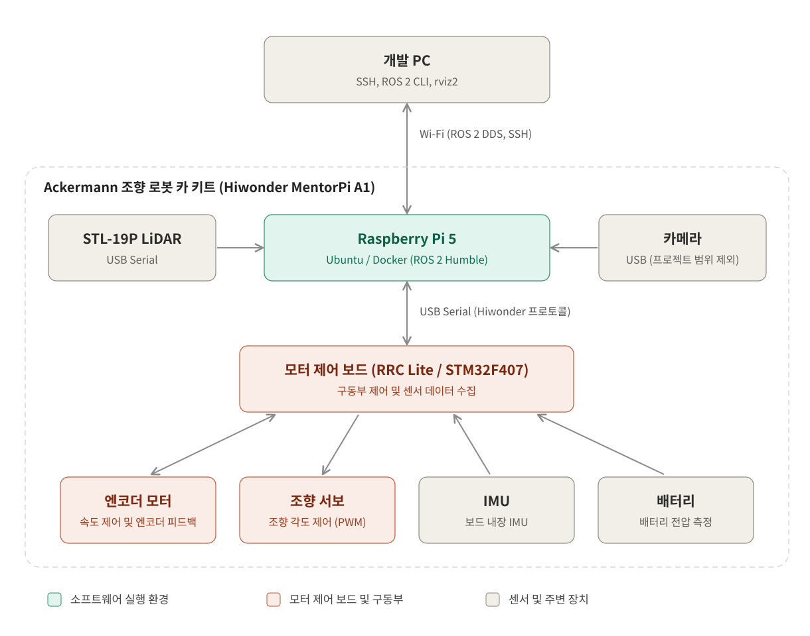
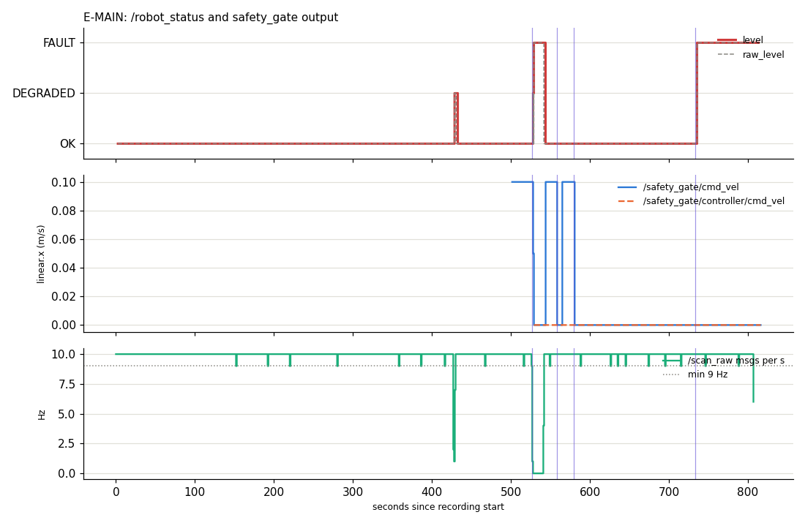

# ROS2 Auto Car

[](https://github.com/hyun-devlog/ros2-autocar/actions/workflows/ci.yml)

ROS 2 기반 이동 로봇의 상태 모니터링 및 안전 제어 시스템입니다. Hiwonder MentorPi A1에서 장애 주입(Fault Injection) 실험을 통해 구현한 기능을 검증했습니다.

> 로봇의 상태를 모니터링하고, 이상 발생 시 주행을 제한하거나 정지 명령을 전달하며, 장애 유형에 따라 정의된 코드를 출력합니다.

## 핵심 결과

Ackermann 조향 방식의 로봇 차량 키트의 바퀴를 지면에서 띄운 상태로 0.1 m/s의 주행 명령을 입력한 뒤 장애를 주입했습니다. rosbag으로 기록한 데이터를 바탕으로 장애 감지 및 대응에 소요된 시간을 측정했습니다.

### 장애 대응 시나리오
| 주입 장애 | 감지 시간(최대) | 정지 명령 출력(최대) | 목표 | 결과 |
|---|---|---|---|---|
| 라이다 끊김 | 2.017 s | 2.068 s | ≤ 2.2 s | 목표 충족 |
| 모터 보드(RRC) 통신 노드 종료 | 2.013 s, 2.058 s | 2.035 s, 2.129 s | ≤ 2.2 s | 목표 충족 |
| 명령 입력 중단 | — | 1.005~1.074 s | ≤ 1.1 s | 목표 충족 |
| 진단 노드(health_monitor) 종료 | — | 0.552 s | ≤ 0.6 s | 목표 충족 |


표의 '정지 명령 출력'은 정상 수신된 메시지 시각부터 safety_gate가 속도 0의 주행 명령을 발행하기까지 소요된 시간을 의미합니다. 

E-01에서는 모터 보트 통신 노드의 종료 처리에 의해 바퀴가 즉시 정지했습니다. 이후 safety_gate가 정지 명령을 발행했으나, 모터 보드 통신 노드가 이미 종료된 상태였으므로 해당 명령은 모터 보드에 전달되지 않았습니다.

**라이다 데이터 수신 중단, 모터 보드 통신 노드 종료, 주행 명령 입력 중단, 진단 노드(health_monitor) 종료에 대한 정지 명령 출력 시간은 모두 설정한 목표 시간을 충족했습니다.**


### 단일 장애점(SPOF) 식별 시험
| 주입 장애 | 확인 내용 | 조치 |
|---|---|---|
| safety_gate 비정상 종료 | safety_gate 종료 시 정지 명령 송출 주체 부재 | 펌웨어 명령 타임아웃 (RR-01) |
| 모터 보드 통신 노드 비정상 종료 | 단일 구동 경로 단절 시 정지 명령 전달 불가 | 하드웨어 비상 정지 (RR-04) |

단일 장애점(SPOF) 식별 시험(E-CRASH)에서는 safety_gate(RR-01)와 모터 보드 통신 노드(RR-04)가 비정상 종료될 경우 현재 시스템 구조만으로는 차량의 정지를 보장할 수 없음을 확인했습니다. 이를 보완하기 위한 개선 방안으로 펌웨어 수준의 타임아웃과 하드웨어 비상 정지를 정의했습니다.


### 실험 영상

#### 안전 제어 동작 검증

**BRINGUP-01 | 주행 명령 입력 중단**

주행 명령 입력 중단 → 약 1초 후 바퀴 정지

[BRINGUP-01 실험 영상](https://drive.google.com/file/d/1epcbWuGNcLr2VyaOawzaJHuR_dRXKn4F/view?usp=sharing)

**E-01 → E-05 | 연속 장애 주입 시험**

라이다 데이터 수신 중단 → 약 2초 후 바퀴 정지 → 라이다 데이터 수신 복구 및 주행 재개 → 진단 노드 (health_monitor) 종료 → 약 0.5초 후 바퀴 정지

[E-01 & E-05 실험 영상](https://drive.google.com/file/d/1UCMoBKDGYdFJJWL_zyMkouGTziGRTCqv/view?usp=sharing) (E-01은 원본 E01_TIME부터, E-05는 E05_TIME부터)

#### 단일 장애점 검증

**E-06 | safety_gate 비정상 종료**

safety_gate 비정상 종료 → 바퀴 회전 지속 → 수동 정지 (단일 장애점 확인, RR-01)

[E-06 실험 영상](https://drive.google.com/file/d/1m6fFbD4O7aCffrUYhZoL1rYdzmr6d-8-/view?usp=sharing)

<details>
<summary>모터 보드 통신 노드 비교 (E-02, E-02b)</summary>
<br>

**E-02 | 모터 보드 통신 노드 정상 종료**

노드 종료 처리에 의해 바퀴 즉시 정지 → 약 2초 후 safety_gate에서 장애 감지 및 정지 명령 출력

[E-02 실험 영상](https://drive.google.com/file/d/1hbS0iNB1aGlSq16TM5uspNZB2X0_rTsO/view?usp=sharing)

**E-02b | 모터 보드 통신 노드 비정상 종료**

모터 보드 통신 비정상 종료 → 바퀴 회전 지속 → 전원 차단 (단일 장애점 확인, RR-04)

[E-02b 실험 영상](https://drive.google.com/file/d/1Pr5K5tJE98Ju-y5ypNUvO9QDckN_8PCJ/view?usp=sharing)

</details>

## 특징

- **기존 코드 수정 없이 통합**: Hiwonder에서 제공하는 토픽을 구독하고, 노드 지정 토픽 remapping을 통해 기존 모터 제어 경로에 안전 제어 노드를 추가합니다.
- **판정 로직과 ROS 2 의존성 분리**: 판정 로직을 rclcpp에 의존하지 않도록 구현하여 실제 로봇없이도 GoogleTest 기반 단위 테스트를 수행할 수 있습니다. (단위 테스트 33개, CI 연동)
- **판정 기준값의 설정 근거 명시**: 공식 문서와 실측 데이터를 기반으로 기준값을 설정하고, 별도의 근거가 없는 값은 설계값으로 구분합니다.
- **안전 요구사항 추적성 확보**: 실험에서 식별한 위험 요소를 안전 요구사항(SR)으로 정의하고, 구현 코드, 단위 테스트 및 실험 결과와 연결하여 관리합니다.
- **잔여 위험 관리**: 실험을 통해 확인한 시스템의 한계를 잔여 위험(Residual Risk)로 기록하고 개선 방안을 정의합니다.

## 구조

### 하드웨어



### 소프트웨어


- 초록색은 이 프로젝트에서 구현한 노드이고, 회색은 기존 소프트웨어와 실행 환경입니다. Hiwonder 코드는 수정하지 않았습니다.
- `odom_publisher`의 명령 입력 두 개(`/cmd_vel`, `/controller/cmd_vel`)를 launch에서 `/safety_gate/*`로 remap해, `odom_publisher`로 들어가는 모든 주행 명령이 safety_gate를 거치도록 구성했습니다.
- health_monitor는 LiDAR(`/scan_raw`), IMU(`imu_raw`), 오도메트리(`odom_raw`) 토픽과 호스트 시스템 상태를 모니터링합니다.
- 모터 제어 보드로 명령을 전달하는 유일한 통신 노드는 `ros_robot_controller` 입니다. 이 노드나 safety_gate가 비정상 종료될 경우 현재 시스템 구조에서는 차량의 정지를 보장할 수 없습니다. (RR-01, RR-04).
- 점선(status_reporter, MQTT)은 로드맵의 지표 v3(원격 상태 보고)에서 구현할 예정입니다.


| 패키지 | 역할 |
|---|---|
| `robot_interfaces` | `RobotStatus`, `FaultItem` 메시지 타입 정의 |
| `health_monitor` | 토픽 수신 시각 및 수신 주기 모니터링, 호스트 시스템 상태 수집, 상태 등급 판정 및 장애 코드를 포함한 `/robot_status` 발행 |
| `safety_gate` | 상태 등급에 따른 주행 명령 제어(PASS / SLOW / STOP), 주행 명령 또는 상태 정보 수신 중단 시 정지 명 출력 |
| `supervisor_bringup` | Hiwonder의 기존 launch 파일을 수정 없이 포함하고, `odom_publisher` 의 두 주행 명령 입력 토픽을 safety_gate의 출력 토픽으로 remapping |

### 상태 등급 및 제어 동작

| 등급 | 의미 | safety_gate |
|---|---|---|
| OK (0) | 모든 모니터링 항목 정상 | 주행 명령 그대로 전달 (PASS) |
| DEGRADED (1) | 성능 저하 상태에서 제한적 주행 가능 | 주행 속도를 기존 명령의 50%로 제한 (SLOW) |
| FAULT (2) | 안전한 주행을 보장할 수 없는 상태 | 모든 주행 명령 경로에 정지 명령을 10 Hz로 출력 (STOP) |
| 상태 없음 / 0.5 s 끊김 | 진단 노드의 상태 정보 확인 불가 | FAULT와 동일한 제어 정책 적용 (STOP) |

장애 유형은 SAE J2012의 DTC(Diagnostic Trouble Code) 형식을 참고하여 정의한 장애 코드로 출력합니다. (예: `U1002` 토픽 수신 중단, `B1002` SoC 온도 85 °C 이상)

전체 장애 코드 목록: [`docs/fault_codes.md`](docs/fault_codes.md)

## 환경 세팅

### 하드웨어 및 소프트웨어 환경

| 항목 | 내용 |
|---|---|
| 로봇 | Hiwonder MentorPi A1 (Ackermann 조향 방식) |
| 상위 제어기 | Raspberry Pi 5 |
| 하위 제어기 | RRC Lite (STM32F407), USB Serial 통신 |
| LiDAR | LD19, `/scan_raw` 토픽 발행 주기 10 Hz |
| 실행 환경 | Hiwonder 기본 시스템 이미지, Docker 컨테이너 `MentorPi` (`ros:humble`) |
| Middleware | ROS 2 Humble, C++17 (rclcpp), Python 3.10 |
| 개발 언어 | C++17 (rclcpp), Python 3.10 |

### 1. 컨테이너 접속

```bash
docker exec -it -u ubuntu -w /home/ubuntu MentorPi zsh
~/.stop_ros.sh          # 자동 시작된 Hiwonder 노드 정리
```

Hiwonder의 기본 실행 환경을 사용하려면 컨테이너에 `root`가 아닌 `ubuntu` 사용자로 접속해야 합니다. 컨테이너의 `~/shared` 디렉터리는 호스트의 `/home/pi/docker/tmp` 디렉터리와 공유되도록 설정되어 있습니다.

### 2. 프로젝트 설치 및 빌드

```bash
cd ~/shared
git clone https://github.com/hyun-devlog/ros2-autocar.git
cd ros2-autocar
colcon build --symlink-install
source install/setup.zsh
echo 'source ~/shared/ros2-autocar/install/setup.zsh' >> ~/.zshrc
```

### 3. 단위 테스트

```bash
colcon test --packages-select health_monitor safety_gate
colcon test-result --verbose      # 33 tests, 0 failures
```

동일한 테스트는 코드 push 시마다 GitHub Actions의 `ros:humble` 컨테이너 환경에서 자동으로 실행됩니다.

## 실행

**안전을 위해 바퀴를 지면에 닿지 않는 상태에서** 실행하세요.

```bash
ulimit -c 0     # Hiwonder LiDAR 드라이버 종료 시 코어 덤프 생성 방지
ros2 launch supervisor_bringup bringup.launch.py
```

실행 시 health_monitor와 safety_gate가 먼저 시작되며, safety_gate는 상태 정보를 수신하기 전까지 STOP 상태를 유지합니다.

```bash
for t in /cmd_vel /controller/cmd_vel /safety_gate/cmd_vel /safety_gate/controller/cmd_vel; do
  echo "== $t"; ros2 topic info -v $t | grep -E "Node name|Endpoint type"
done
```

주행 명령을 입력하기 전에 토픽의 구독 관계를 확인하여 주행 명령 전달 경로가 올바르게 구성되었는지 검증합니다.
- `/cmd_vel`, `/controller/cmd_vel`: safety_gate만 구독
- `/safety_gate/cmd_vel`, `/safety_gate/controller/cmd_vel`: odom_publisher가 구독

## 실험 방법

### 도구

| 도구 | 용도 |
|---|---|
| `tools/record_experiment.sh <ID>` | 상태 정보·주행 명령·safety_gate 출력 및 센서 토픽을 rosbag으로 기록. 전원 차단 시 데이터 손실을 최소화하기 위해 캐시를 비활성화하고 1초 간격으로 sync 실행 |
| `tools/run_logged.sh <log> <command>` | 노드 실행 로그를 터미널에 출력하고 파일에 저장 |
| `tools/bag_timeline.py <bag>` | 토픽 수신 중단 및 재개 시점·메시지 값 변화를 시간순으로 출력 |
| `tools/supervisor_metrics.py <bag...>` | 장애 발생 구간을 자동으로 식별하고 성능 지표를 계산하여 결과 표 및 그래프 생성(`python3-matplotlib` 필요). 지표 정의: [`docs/metrics.md`](docs/metrics.md) |

### 절차

1. 차량의 바퀴를 지면에 띄운 상태에서 bringup 실행하고 주행 명령 전달 경로를 확인합니다.
2. `tools/record_experiment.sh E-xx`를 실행하여 rosbag 데이터 기록을 시작합니다.
3. 다음 명령을 실행하여 0.1 m/s 의 주행 명령을 10 Hz로 발행합니다.
  ```
  `ros2 topic pub -r 10 /cmd_vel geometry_msgs/msg/Twist "{linear: {x: 0.1}}"`
  ```
4. 시나리오별 장애를 주입하고 바퀴의 동작을 관찰하며 실험 영상을 촬영합니다.
5. 데이터 기록을 종료한 후 `tools/supervisor_metrics.py`를 실행하여 실험 결과를 분석합니다.

| ID | 장애 | 주입 및 검증 방법 | 관련 |
|---|---|---|---|
| E-01 | LiDAR 데이터 수신 중단 | `pkill -INT -f ldlidar_stl_ros2_node` | SR-01, SR-09 |
| E-02 | 모터 보드 통신 노드 정상 종료 | `kill -INT <ros_robot_controller PID>` | SR-02 |
| E-03 | 주행 명령 입력 중단 | Ctrl+C 로 주행 명령 발행 종료 | SR-04 |
| E-04 | 주행 명령 우회 경로 확인 | `ros2 topic info -v`로 토픽 구독 관계 확인 | SR-05 |
| E-05 | 진단 노드 종료 | `pkill -INT -f health_monitor_node` | SR-13 |
| E-06 | safety_gate 비정상 종료 | `kill -KILL <safety_gate PID>` | 잔여 위험 RR-01 |
| E-02b | 모터 보드 통신 노드 비정상 종료 | `kill -KILL <ros_robot_controller PID>` | 잔여 위험 RR-04 |

`pkill -f`는 전체 명령줄을 기준으로 프로세스를 검색하므로, 검색 조건과 일치하는 다른 프로세스(예: rosbag 기록 프로세스)도 종료될 수 있습니다. 검색 조건이 중복되는 경우에는 pgrep -af로 대상 프로세스의 PID를 확인한 후 해당 프로세스만 종료합니다.

## 결과

전체 실험 결과: [`docs/metrics/summary.md`](docs/metrics/summary.md) · 상세 실험 기록: [`docs/experiments/`](docs/experiments/)

### LiDAR 데이터 수신 중단 및 진단 노드 종료 (E-01, E-05)

LiDAR 데이터 수신 중단 후 약 2.0 s에 FAULT 상태로 전환되었으며, safety_gate에서 정지 명령을 출력했습니다. 데이터 수신이 복구된 후에는 2.0 s의 복구 대기 시간을 거쳐 주행을 재개했습니다.

진단 노드 종료 시에는 safety_gate가 상태 정보 수신 중단을 감지하여 0.55 s 후 정지 명령을 출력했습니다. 



### 주행 명령 입력 중단 (E-03)

두 주행 명령 입력 토픽(`/cmd_vel`, `/controller/cmd_vel`)을 대상으로 입력 중단 실험을 수행했습니다.

각 실험에서 약 1.04 s 후 정지 명령을 1회 출력한 뒤 명령 발행을 중단했습니다. 사용하지 않는 입력 경로에서 정지 명령을 지속적으로 출력할 경우, 다른 입력 경로의 정상 주행 명령을 덮어쓸 수 있기 때문입니다.


### 모터 보드 통신 노드 정상 종료 (E-02)

IMU 데이터 수신 중단을 통해 모터 보드 통신 장애를 약 2.01 s에 감지했습니다. `/odom_raw`토픽은 모터 보드 통신 노드가 종료된 이후에도 계속 발행되었으므로, 해당 토픽만으로는 모터 보드 통신 장애를 감지할 수 없었습니다.

실제 바퀴 정지는 모터 보드 통신 노드의 정상 종료 처리에 의해 이루어졌으며, 이후 safety_gate에서 출력한 정지 명령은 모터 보드에 전달되지 않았습니다.


### safety_gate 비정상 종료 (E-06)

safety_gate가 정지 명령을 출력하지 못한 상태에서 비정상 종료되었으며, 기존 드라이버가 마지막 주행 명령을 유지하며 바퀴가 21.2 s 동안 계속 회전했습니다.

센서 데이터는 정상적으로 수신되고 있었으므로 health_monitor의 정상 가동률은 **100%**로 측정되었습니다. 이를 통해 상태 모니터링 지표만으로는 안전 제어 기능의 정상 동작을 판단할 수 없음을 확인했습니다.


## 주요 실험 결과 및 개선 사항 (Findings)

| 확인 사항 | 원인 분석 및 검증 결과 | 개선 사항 |
|---|---|---|
| 정상 LiDAR 동작 중 반복적인 감속 발생 | 2분 동안 3회의 감속 발생. 초기에는 수신 주기 변동을 원인으로 추정했으나, 측정 결과 약 35 s마다 스캔 데이터 1개가 누락되면서 1 s 측정 구간의 수신율이 8.89 Hz로 감소하는 것을 확인 | 수신율 측정 구간을 2 s로 변경(9.47 Hz)하고 회귀 테스트 추가. 523.9 s 동안 데이터 누락 15회, 오탐 0회 ([RATE-01](docs/experiments/RATE-01.md)) |
| 안전 제어 노드를 우회하는 주행 명령 경로 | 바퀴 구동 전 ROS 2 토픽 연결 관계를 확인하는 과정에서 launch 설정 오류로 `/controller/cmd_vel`이 모터 제어 경로에 직접 연결된 것을 확인 | launch 설정 수정 및 구독 관계 재검증. 토픽 연결 관계 확인을 실험 절차에 포함 ([BRINGUP-01](docs/experiments/BRINGUP-01.md)) |
| `/odom_raw` 기반 모터 보드 통신 장애 감지 불가 | 모터 보드 통신 노드 종료 이후에도 /odom_raw 토픽이 29 s 동안 계속 발행됨을 확인 | 모터 보드 통신 상태 판정에 IMU 토픽 사용 ([E-02](docs/experiments/E-02.md)) |
| LiDAR 데이터의 일시적인 수신 중단 | 실험 준비 과정에서 의도하지 않은 1.5 s의 데이터 수신 중단 발생. 장애 판정 타임아웃 미만이므로 감속 정책 적용 | 실제 데이터 수신 이상에 대한 단계별 제어 정책의 동작 확인 ([E-MAIN](docs/experiments/E-MAIN.md)) |
| 안전 제어 및 모터 보드 통신 경로의 단일 장애점 | safety_gate 비정상 종료 후 21.2 s 동안 바퀴 회전 지속. 모터 보드 통신 노드 비정상 종료 시 전원 차단으로 정지. 펌웨어 수준의 명령 타임아웃 부재 | 잔여 위험 RR-01, RR-04로 기록하고 개선 방안 검토 ([E-CRASH](docs/experiments/E-CRASH.md)) |
| 진단 노드 재시작 시 데이터 수신 전 OK 상태 발행 | 초기화 유예 시간 5 s 동안 아직 수신되지 않은 토픽을 장애 판정 대상에서 제외 | 잔여 위험 RR-03으로 기록하고 초기화 구간의 상태 판정 로직 개선 예정 |

## 안전 설계 접근

> 본 프로젝트는 기능안전 관련 표준의 준수 여부를 검증하거나 인증받은 프로젝트가 아닙니다.
> 현대자동차그룹의 HINT 모빌리티 AI 교육에서 학습한 기능안전 방법론을 참고하여 개인 로봇 차 프로젝트의 위험 분석, 안전 요구사항 정의 및 검증 과정에 적용했습니다. 
> 상세 설계 및 검증 내용 : [`docs/safety.md`](docs/safety.md)

| 참고한 설계 개념 | 프로젝트 적용 내용 |
|---|---|
| 위험 분석 및 안전 요구사항 정의 | 위험 요소 H-01~H-13 식별 및 안전 요구사항 SR-01~SR-14 정의 |
| 안전 상태 (Safety State) | 모든 주행 명령 출력 경로에 정지 명령 출력 |
| 장애 감지 및 대응 시간 (FTTI 개념 참고) | 장애 주입 실험을 통한 장애 감지 시간 및 정지 명령 출력 시간 측정 |
| V-Model 및 양방향 추적성 | 안전 요구사항(SR), 구현 코드, 단위 테스트 및 실험 결과 간 추적 관계 정의 |
| 잔여 위험(Residual Risk) | 현재 시스템에서 대응할 수 없는 장애 조건을 RR-01 ~ RR-04로 정의하고 실험 근거 및 개선 방안 기록 |

ISO 26262는 도로 차량용의 전기·전자 시스템에 대한 기능안전 표준이며, Automotive SPICE는 개발 프로세스의 역량을 평가하기 위한 모델입니다.

본 프로젝트에서는 해당 표준과 모델의 설계 및 검증 개념을 참고했습니다. 실제 운용 환경에서의 심각도(Severity), 노출도(Exposure), 통제 가능성(Controllability)을 평가할 근거가 충분하지 않으므로 ASIL 등급은 산정하지 않았습니다.

## 저장소 구조

```
├── robot_interfaces/      ROS 2 메시지 정의
├── health_monitor/        상태 모니터링 및 장애 판정
│                          (health_core: ROS 2 독립 판정 로직, 단위 테스트 25개)
├── safety_gate/           주행 명령 제어
│                          (gate_core: ROS 2 독립 제어 로직, 단위 테스트 8개)
├── supervisor_bringup/    시스템 통합 실행 및 토픽 remapping
├── tools/                 데이터 기록, 로그 수집, 타임라인 및 지표 분석 도구
├── docs/
│   ├── safety.md          위험 분석, 안전 요구사항, 추적 관계 및 잔여 위험
│   ├── fault_codes.md     장애 코드 정의
│   ├── metrics.md         성능 지표 정의
│   ├── metrics/           실험 결과 표 및 그래프
│   └── experiments/       시나리오별 실험 기록 
└── .github/workflows/     CI 워크플로
```

## 로드맵

- [x] ROS 2 메시지 정의 및 health_monitor, safety_gate, supervisor_bringup 구현
- [x] 단위 테스트 작성 및 GitHub Actions 기반 CI 구축
- [x] 실제 차량 기반 장애 주입 실험 및 지표 분석 v1 구현 (rosbag 데이터 기반 결과 표 및 그래프 생성)
- [ ] 노드 비정상 종료 대응을 위한 하드웨어 비상 정지 및 펌웨어 명령 타임아웃 검토 (RR-01, RR-04)
- [ ] 진단 노드 초기화 유예 구간의 상태 판정 로직 개선 (OK → DEGRADED, RR-03)
- [x] 모터 보드 통신 노드 비정상 종료 실험 재수행 및 데이터 기록 방식 개선을 통한 장애 감지 시점 측정
- [ ] 개선된 데이터 기록 방식으로 모터 보드 통신 노드 비정상 종료 실험을 재수행하여 장애 감지 시점 측정
- [ ] 지표 분석 v2: PlotJugger / Foxglove 기반 실시간 모니터링 환경 구성
- [ ] 지표 분석 v3: MQTT 기반 원격 상태 전송 및 Prometheus / Grafana 연동
- [ ] 지표 분석 v4: CI 환경에서 rosbag 데이터 재생 및 명령 출력 시간 회귀 테스트 자동화 
- [ ] Docker Compose 기반 실행 환경 구성(restart 정책, `init: true` 설정)
- [ ] CPU 및 메모리 사용량 실측을 통한 판정 기준값 설정 (SR-11, SR-12)

## 참고 자료

- ISO 26262-1:2018: https://www.iso.org/standard/68383.html
- Automotive SPICE (VDA QMC): https://vda-qmc.de
- SAE J2012: https://saemobilus.sae.org/standards/j2012_201612-diagnostic-trouble-code-definitions
- 판정 기준값 및 설정 근거: [`docs/safety.md`](docs/safety.md) 9절
